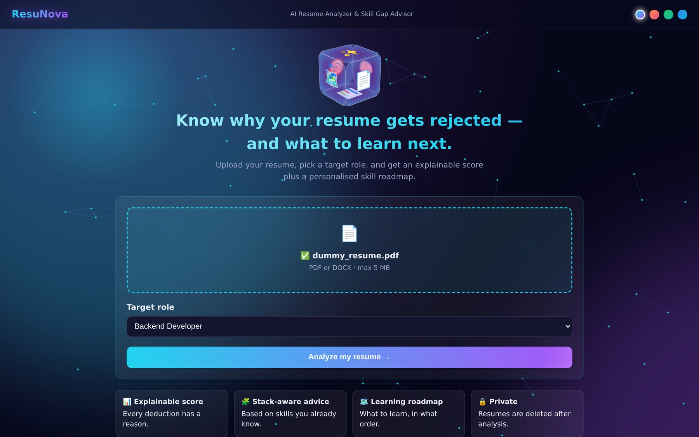
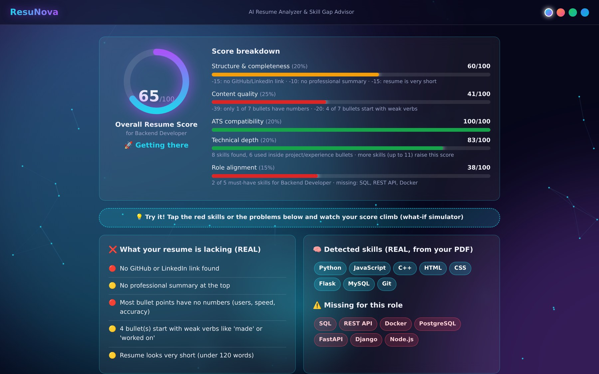
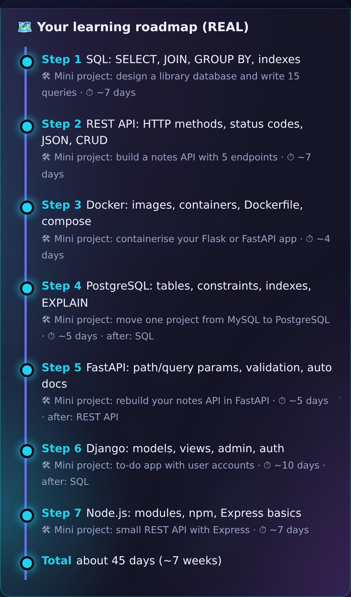

# ResuNova: AI Resume Analyzer and Skill Gap Advisor

Upload a resume, pick a target role, and get an **explainable score out of 100**, the **skills you have and lack**, and a **learning roadmap in which prerequisites come first**. No job description is needed, and no account.

> Status: Version 1 prototype, built as a first-year project (course CSL120, The NorthCap University, Gurugram) by Divyansh.

| Upload | Results | Roadmap |
|---|---|---|
|  |  |  |

## What it does

- Reads **PDF and DOCX** resumes (up to 5 MB).
- Detects **29 skills** by whole-word matching (so "Java" is not found inside "JavaScript").
- Scores the resume in **five categories** (structure, content quality, ATS compatibility, technical depth, role alignment) and shows the **reason for every deduction**.
- Compares the detected skills with a target role (**Backend, Frontend, Data Analyst, ML Engineer**) and ranks what is missing.
- Builds a **roadmap sorted by prerequisites** (for example, JavaScript before React), with a mini project and a time estimate for each step.
- Suggests **rule-based rewrites** for weak bullet points. It adds `[N]`-style placeholders and never invents numbers or experience.

## Run it locally

```bash
python -m venv venv
# Windows (PowerShell):  Set-ExecutionPolicy -Scope Process -ExecutionPolicy Bypass ; venv\Scripts\activate
# macOS / Linux:         source venv/bin/activate
pip install -r requirements.txt
cd backend
uvicorn main:app --reload
```

Open <http://127.0.0.1:8000>. The API documentation is at <http://127.0.0.1:8000/docs>.

## Run with Docker

```bash
docker build -t resunova .
docker run -p 8000:8000 resunova
```

## Deploy

The app is one container that serves both the API and the web page. On a host such as Render:

1. Push this repository to GitHub.
2. Create a **Web Service** from the repository and choose the **Docker** runtime (or use the included `render.yaml`).
3. Set the health-check path to `/api/health`.

Free hosting tiers usually **sleep when idle** (the first request can take up to a minute) and have **temporary disk space**, so saved reports may be lost on restart. The skills and roles are re-created automatically on every start. Check your host's current free-tier terms before relying on it.

### Settings (environment variables)

| Variable | Default | Meaning |
|---|---|---|
| `PORT` | `8000` | Port the server listens on (set by most hosts) |
| `ALLOWED_ORIGINS` | localhost and `null` | Browser origins allowed by CORS. A hosted site does not need any. |
| `RATE_LIMIT_PER_10MIN` | `20` | Requests per IP address per ten minutes for upload and analyze |
| `RESUNOVA_DB` | `backend/resunova.db` | Location of the SQLite file |

## API

| Endpoint | Purpose |
|---|---|
| `GET /api/health` | Health check |
| `GET /api/roles` | Target roles with their must-have and important skills |
| `POST /api/upload` | Upload a resume and role; returns an `upload_id` (held in memory for at most 10 minutes) |
| `POST /api/analyze` | Run the analysis on a file or an `upload_id`; returns the report |
| `GET /api/report/{id}` | Fetch a saved report |
| `GET /api/roadmap/{id}` | Fetch the roadmap of a saved report |

## Tests

```bash
pip install -r requirements-dev.txt
cd backend
python run_tests.py
```

The script checks eight edge cases (short, long, table layout, scanned PDF, DOCX, wrong file type, corrupt file, empty file), timing, section detection, the rate limiter and the API endpoints. The same script runs on every push through GitHub Actions.

## Project structure

```
backend/      FastAPI app (main.py), SQLite layer (db.py), skills and roles (seed_data.py), tests
frontend/     index.html (the app), demo.html (sample-data demo), privacy.html
docs/         screenshots
Dockerfile    one-container deployment
```

## Privacy

Resume files and their text are never written to disk. Only derived results (score, skills, problems, roadmap) are saved. See `frontend/privacy.html`.

## Limitations

- The role profiles, prerequisites and learning notes are **written by hand**; they are not mined from job data yet.
- Skills are matched from a list of 29 skills, so unusual wording or unlisted skills are missed.
- Scoring weights are initial values and have **not yet been validated** on a labelled set of resumes.
- The rewrites are rule-based and must be checked by the user.
- ResuNova gives guidance, not a guarantee of selection by any employer.

## Roadmap

- Evaluate on 30 to 50 labelled resumes (precision, recall, F1) and tune the scoring.
- Build role profiles and skill co-occurrence from job-posting data.
- spaCy phrase matching and embeddings for skills written in different ways.
- Language-model feedback, and a what-if simulator tied to the real score.
